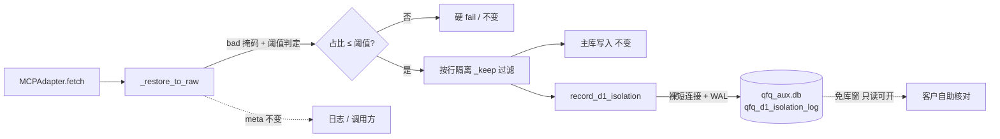

# D1-补1 隔离登记落盘通道 · 新增独立表方案（六步流水线 ①）

**提出**：主仓 dev 会话 ｜ **日期**：2026-10-17 ｜ **状态**：**①方案，已按 ②审 2026-10-17 意见修订，待 ②审复核**（本轮不出代码、不改 schema、不写簿记）
**承接**：`docs/handoff/dev-queue-handoff-20261016.md` §1.1（D1-补1 / 条件 A）
**上游方案**：`docs/rebase-failfast-d1-d7-unified-design-20261013.md`（已过 ②审，commit `486882d`）
**总调度 2026-10-17 裁定**：落盘载体采 **(a) 新增独立表**，不给既有表加列、不塞 `last_error`。

---

## 知识反哺检索留痕

知识反哺：[命中] 验收盲点-skipna因子合成缺列不可区分须审计行直证（07-经验库/验收盲点-skipna因子合成缺列不可区分须审计行直证.md，2026-10-11）— 「审计行是唯一可机检判据，日志推断会翻车」⇒ **采纳**：本表定位为**审计行直证**，不是日志增强；客户核对必须走结构化列，禁止把载荷塞进自由文本。
知识反哺：[命中] 平台转换坑-必填参数空串未定义行为返回静默空（07-经验库，2026-10-11）— 「静默失败一次就暴露」⇒ **采纳**：落盘失败必须 ERROR 审计行兜底（见 §5 fail-soft 义务②）。
知识反哺：[命中] 准入裁决函数唯一性（07-经验库）— 「新增词表/枚举值须先取实际在用集并加值域断言，否则多套词表静默混入」⇒ **采纳并已实读核对**：①`asset_type` 复用 `MCPAdapter._asset_type_of(table)`，其值域为 `{"ETF","STOCK"}`（`mcp_adapter.py:1810-1811`），与既有 `qfq_deep_audit_item` 侧词表**同构不分裂**（`qfq_resident_orchestrator.py:1358` 明写「STOCK/ETF」，L1223 统一 `strip().upper()`，L715 判 `== "ETF"`）⇒ **禁止新造第三套词表**；②`kind` 枚举在本表落值域断言（照 P8-001 同型做法）。
知识反哺：[无命中] 检索域：06-数据与工具、11-方法论与工程体系；主题词：D1 隔离登记 / 落盘表设计 / 截断标记 —— **主库无相关条目**，2026-10-17。
知识反哺：[新增·待回灌] **交接件写库类落点必须核到列级，不得只核表名/主键** ——
· **来源**：上游交接件疏漏。`docs/handoff/dev-queue-handoff-20261016.md` §1.1 把 `qfq_deep_audit_item` 写成"既有通道·可直接复用"，但**只核到表名与主键，未核列清单**；7 列中无任何列可承载三组键这一事实，直到接手方复核与 ②审共同才暴露。
· **兜住机制**：本轮由**接手方复核（列级核对）+ ②审（独立复测 PK 与列）**双重兜住，任一环节单独存在都可能放行。
· **规律**：凡"复用既有落库通道"的主张，核到**表存在**只是半程，必须核到**列能否承载载荷**；若该表进契约校验体系，还须核**校验器的调用时机与位置**（见 §9.1）。
· **回灌形态**：Obsidian 主库 `11-方法论与工程体系`，随本线自己的提交轮并入回灌动作（当前 §12 已列为待落簿记项，不在本轮写）。

---

## 1 问题定义

D1（缺因子按比例隔离）与 a0（整码全缺升级告警）已落地，四组登记键**只存在于返回的 `meta` 字典**（`mcp_adapter.py` L2142 / L2143 / L2168 / L2169），**无任何 DB 写入**。后果：

1. **客户无法自助核对**。上游方案 §4 承诺「隔离登记可外部只读查（`qfq_deep_audit_item`，免库窗）」——该承诺当前**未兑现**。
2. a0 场景（整码全缺）客户端表现为「悄悄少一只票」，而证据只在一行 WARNING 日志里，日志滚动即丢失。

**为何不能复用既有表**：`qfq_deep_audit_item` 全列仅 7 个（`asset_type / code / status / round_no / attempt_count / last_error / updated_at`，DDL 见 `qfq_reanchor_schema.py` L559-568），**无任何列可承载 `skipped_rows_no_factor` / `missing_factor_codes` / `whole_code_missing(_count)`**。塞 `last_error` 会让「失败原因」与「隔离登记载荷」两种语义在同一字段打架，且客户无法机检解析。

## 2 改动范围（允许写入清单，越界即回滚）

| # | 文件 | 改动性质 |
|---|---|---|
| 1 | `quantstudio/pipeline/qfq_reanchor_schema.py` | `DDL_SQLITE` 新增**一张**表（库表契约变更点，唯一 schema 变更） |
| 2 | `quantstudio/pipeline/qfq_unit_diag.py` | 新增 `record_d1_isolation(...)`（不复用 `record_unit_outcome`，见 §6） |
| 3 | `quantstudio/pipeline/sources/mcp_adapter.py` | `_restore_to_raw` 内调用点（**共享核心文件**） |
| 4 | `tests/test_restore_missing_factor_d1_a0_d2.py` | 启用末尾 skip 用例 |

**禁止**：改 `qfq_deep_audit_item` 结构；改 D1/a0 的判定、阈值、`_keep` 过滤与写入主库的字节；改任何既有 meta 键的取值与截断行为。

## 3 数据流（影响面）



唯一新增边＝`G→H`；`B→F`（主库写入）与 `B→J`（meta/日志）**字节不变**。

## 4 表结构（DDL 提案）

```sql
CREATE TABLE IF NOT EXISTS qfq_d1_isolation_log (
    asset_type          TEXT    NOT NULL,   -- 值域 {ETF, STOCK}：复用 _asset_type_of()，已实读核实与既有审计表同构
    code                TEXT    NOT NULL,
    round_no            INTEGER NOT NULL,   -- 业务日 YYYYMMDD（与 qfq_deep_audit_item 同构）
    batch_id            TEXT,               -- 溯源：f"{table}/{freq}" + 批次序号，不参与 PK
    table_name          TEXT,
    freq                TEXT,
    kind                TEXT    NOT NULL,   -- 值域：row_skipped | whole_code_missing（本表落值域断言）
    skipped_rows        INTEGER DEFAULT 0,  -- 该码被跳过的行数
    total_rows          INTEGER DEFAULT 0,  -- 该批总行数（用于客户复算占比）
    missing_codes_total INTEGER DEFAULT 0,  -- 该批缺因子的总码数（不受 [:50] 截断影响）
    listed_codes        INTEGER DEFAULT 0,  -- 实际落盘的码行数
    truncated           INTEGER DEFAULT 0,  -- ★截断标记：listed_codes < missing_codes_total 时置 1
    missing_ratio       REAL,               -- 实测占比
    max_ratio           REAL,               -- 当时生效阈值（回退核对用）
    whole_code_missing  INTEGER DEFAULT 0,  -- 0/1，该码是否整码全缺
    hit_count           INTEGER DEFAULT 1,  -- ★同日累计命中次数：UPSERT 时 +1（防"最后写胜"覆盖曾被跳过的证据）
    updated_at          TEXT    NOT NULL,   -- ★最近一次命中时刻（判新鲜度：客户第二问"这条是什么时候的"）
    PRIMARY KEY (asset_type, code, round_no)
)
```

**UPSERT 口径**：`ON CONFLICT(asset_type, code, round_no) DO UPDATE SET hit_count = hit_count + 1, skipped_rows=excluded.skipped_rows, ..., updated_at=excluded.updated_at`。即**计数累加、载荷取最后一次**。

**粒度**：**一码一行**（全量码，不截断），批次级事实（`total_rows` / `missing_codes_total` / `listed_codes` / `truncated` / 阈值）**冗余复制到该批每一行**——刻意反范式，目的是让免库窗单行读取即可自证，不必 JOIN 另一张表。

**为什么这样就满足「截断标记」**：D1 的 `meta["missing_factor_codes"]` 被 `[:50]` 截断，若登记沿用截断后的列表，客户核对到第 51 个码时会以为「就这些」。落盘用**全量 `bad_codes`**（调用点拿得到未截断的列表），`meta`/日志维持 50 截断不变；于是 `missing_codes_total`（真值）与 `listed_codes`（已落盘）并列，`truncated` 显式告诉客户「你看到的这份是否完整」——**可机检，不靠人眼比对**。

**`round_no` 语义与 `hit_count`（②审裁定：维持 PK + 加计数器，取中间解）**：

同码同日 UPSERT，跨零点批次落相邻两日为已知边界（与 `qfq_deep_audit_item` 同构）。**但"最后写胜"单独用有一个具体隐患**：同码同日若「先被跳过、后续重试成功」，最后写会把「它曾被跳过」的证据覆盖掉 ⇒ 客户看到"今天没漏"，而实际早上漏过一次。

两个候选方案都不是最优——逐批 `batch_id` 入 PK 能留全流水，代价是表按批次增长并需配套保留期（为留痕引入运维负担）；纯最后写胜则丢证据。**采中间解：PK 不变、新增 `hit_count`，UPSERT 时 `hit_count = hit_count + 1`** ⇒ 计数累加保住"今天漏过几次"的证据，载荷取最后一次，同时表增长仍被 `#码 × #日` 封顶。客户真实要的正是"今天有没有漏、漏了几次"，而非"每一批的流水"。

## 4.1 免库窗读取路径（客户可直接跑，只读、不开主库窗、不启 daemon）

```sql
-- 数据源：qfq_aux.db（纯检测辅助库，免库窗只读可开）
-- Q1 今天有没有漏？漏了哪些码？漏了几次？
SELECT code, kind, whole_code_missing, skipped_rows, hit_count, updated_at
FROM   qfq_d1_isolation_log
WHERE  round_no = CAST(strftime('%Y%m%d','now','+8 hours') AS INTEGER)
ORDER  BY whole_code_missing DESC, skipped_rows DESC;

-- Q2 所见是否完整？（truncated=1 表示码列表被截断，missing_codes_total 才是真值）
SELECT round_no, listed_codes, missing_codes_total, truncated
FROM   qfq_d1_isolation_log
WHERE  truncated = 1
GROUP  BY round_no;

-- Q3 复算占比是否与 meta 一致（客户自查跳过的合法性）
SELECT table_name, freq, total_rows, missing_ratio, max_ratio, truncated
FROM   qfq_d1_isolation_log
WHERE  round_no = CAST(strftime('%Y%m%d','now','+8 hours') AS INTEGER)
LIMIT  1;
```

读取口径承诺：**只读连接直接开 `qfq_aux.db` 即可，不依赖主库锁、不触发停服窗**（该库定位「纯检测辅助数据、不参与价格原子事务」）。

## 5 fail-soft 义务三条（总调度 2026-10-17 必加项）

落盘是**旁路观测**，绝不可改变还原行为。三条义务：

| # | 义务 | 判据 |
|---|---|---|
| **①** | **绝不向取数路径抛出** | 落盘任何异常都不得冒泡到 `_restore_to_raw` 的调用方，不中断本批/本轮（照 `code_contract`「拒绝⇒隔离计数 + 审计行，不中断整批/整轮」） |
| **②** | **失败必须留 ERROR 审计行，禁止静默 `return False`** | 与 `record_unit_outcome` 的 `log.error` 同形；客户不得遇到「登记缺失但无人告知」 |
| **③** | **不触价格事务、不写主库** | 仅 `sqlite3` 短连接写 `qfq_aux.db`；不参与主库锁、不进原子事务、不改任何主库表 |

**覆盖的三类失败面**（每类都须走 fail-soft + ERROR）：

1. **表不存在**——`record_unit_outcome` 是裸 `sqlite3.connect`、**不调** `init_sqlite_schema`，故在「init 尚未跑过」的库上本表可能不存在。处置：`sqlite3.OperationalError: no such table` ⇒ ERROR + `return False`，**不**在热路径上补跑全量 DDL（5 条生产调用路径会经过此处）。
2. **写冲突/超时**——`OperationalError: database is locked` ⇒ ERROR + `return False`，设有限 `timeout`（沿用 `record_unit_outcome` 的 `timeout=5`）。
3. **其他异常**——兜底 `except Exception` ⇒ ERROR + `return False`。

## 6 为什么不复用 `record_unit_outcome`

`record_unit_outcome` 受 `QS_QFQ_UNIT_DIAG` 开关控制（默认开，但客户可置 0）。D1 的免库窗核对是**对客户的书面承诺**，不应随一个内部诊断开关消失。故新增独立函数、不受该 env 约束（其失败面由 §5 义务②自行兜住）。代价是多一个函数——可接受，因为二者语义本不相同（逐单元 outcome vs 批次隔离登记）。

## 7 判型声明

**新增检测型**——新增登记通道，开始报告真相；**既有可观察结果不变**：还原判定、阈值、`_keep` 过滤、主库写入字节、meta 键值与截断全部零改动。新增红必须为 0。

## 8 验收标准

1. **写入三组键**：`skipped_rows_no_factor` / `missing_factor_codes` / `whole_code_missing(_count)` 在触发隔离的批次后落表，计数与 `meta` **逐位一致**。
2. **全量码 + 截断标记**：构造 >50 个缺因子码的场景，断言 `listed_codes == missing_codes_total == 实际码数` 且 `truncated == 0`；构造被上限截断的场景断言 `truncated == 1`。**（截断标记列的直接验收）**
3. **未触发路径零副作用**：不满足 `占比 ≤ 阈值`（走硬 fail）或正常全还原路径时，本表**零写入**。
4. **异常兜住**：注入写失败（表缺失 / 锁占用），断言**取数不抛**、**ERROR 日志产生**、返回 `False`。（fail-soft 三条的直接验收）
5. **免库窗可读**：以只读连接打开 `qfq_aux.db`（不开主库窗、不启 daemon），**实跑 §4.1 三条查询**并贴出结果——承诺必须能被客户真的用起来，而不只是"技术上可读"。
6. **值域断言**：`kind` 只接受 `row_skipped` / `whole_code_missing`，越域抛错（照 07-经验库「准入裁决函数唯一性」+ P8-001 同型）。
7. **`hit_count` 防覆盖**：同一 `(asset_type, code, round_no)` 连续命中 3 次 ⇒ `hit_count == 3` 且行只有一条；构造「先跳过→后重试成功」，断言 `hit_count >= 1` **未被清零**（即"曾被跳过"的证据未被最后写胜覆盖）。
8. **既有固件不回归**：`tests/test_restore_missing_factor_d1_a0_d2.py` 13 条全绿 + skip 用例转绿；D1/a0/D2 相关既有测试全绿。
9. **`qfq_deep_audit_item` 零改动**：`git diff` 中该文件不出现（连带证明未走"给既有表加列"的被否方案）。

## 9 影响面与零迁移核实

### 9.1 零迁移已核实（不是推断）

> 格式约定：本节每条声称「已核实」的结论均附**实测出处**；未能实测的一律写「待核」，不得以推断充当核实（②审 2026-10-17 认可此格式）。

**表为什么会自动出现**——`init_sqlite_schema` 无条件遍历 `DDL_SQLITE` 执行每条 DDL，全部为 `CREATE TABLE IF NOT EXISTS`。出处：`qfq_reanchor_schema.py` **L748-751**。

**存量库会不会被跑到**——生产侧 5 处调用该函数，故任一生产路径初始化即建表。出处：`qfq_aux_router.py:162`、`qfq_resident_orchestrator.py:274`、`qfq_observation.py:195`、`qfq_event_discovery.py:437` 与 `:571`、`qfq_reanchor_schema.py:974`。

**唯一的翻车点及其排除（本节核心）**——新增表会因 `SCHEMA_CONTRACT_SQLITE` 由 `DDL_SQLITE` 自动派生而**自动进入契约回读校验**，而 `_verify_sqlite_contract` 对契约内每张表逐列 `PRAGMA table_info` 回读、**缺列即 `raise RuntimeError`**。若该校验跑在只读连接上、或早于建表执行，则"零迁移"会翻车成「首次只读访问即红」。三条实测将其排除：

| 疑点 | 实测出处 | 结论 |
|---|---|---|
| 新表是否自动进契约 | `qfq_reanchor_schema.py:849-850`（`SCHEMA_CONTRACT_SQLITE` 由 `DDL_SQLITE` 字典推导） | 是，故必须查调用序 |
| 校验是否缺列即抛 | `qfq_reanchor_schema.py:901-930`（`PRAGMA table_info` 缺列 → `RuntimeError`） | 是，风险真实存在 |
| 调用序是否先建后校 | `qfq_reanchor_schema.py:974` `init_sqlite_schema(sconn)` → **`:976` `_verify_sqlite_contract(sconn)`**，同连接、同把写锁（`locked_connect` L969） | 先建后校 |
| 是否还有别的只读调用点 | 全仓检索 `_verify_sqlite_contract` 仅命中定义处 L901 与唯一调用处 L976 | 无只读旁路 |

⇒ **结论：存量 `qfq_aux.db` 零迁移、无迁移器、无回退面**，且不存在「首次只读访问即红」。

> 记取此处的论证纪律：仅凭「DDL 是 `IF NOT EXISTS` 所以没事」属**半程论证**——真正决定成败的是**校验器的调用时机与位置**。凡涉及"新增对象进既有校验体系"的结论，必须核到校验器本身，不可停在建表语句。

### 9.2 其余影响面

**库窗**：写 `qfq_aux.db`（纯检测辅助、不参与价格原子事务、免库窗只读可开），**不需要停服窗**。若实施中任何一步需要触碰主库，立即停手上报。

**既有表零改动**：`qfq_deep_audit_item` 的 DDL、列、PK、写入路径均不动（`git diff` 应显示该文件无变更）。

## 10 回退条件与手段

| 触发 | 回退 |
|---|---|
| 验收 1-7 任一不过 / 既有测试转红 | 按路径单文件从快照提取复原：`git show <hash>:<path>`（**禁整仓 `stash pop`**，快照可能混入他线改动） |
| 落盘引发还原行为漂移 | 立即摘除 `mcp_adapter.py` 调用点（本表残留无害，不影响既有功能） |
| 表结构引发既有契约校验红 | 移除 `DDL_SQLITE` 条目即可（`CREATE TABLE IF NOT EXISTS` 不会自动删表，残留表只读无害） |

**回退点**：实施前按**定 scope 四步配方**建快照（`git add -A -- <三个目标文件>` → `git stash create` → `git stash store` → `git reset`），hash 记入会话记录。

## 11 实施编排（待 ②审通过后）

1. 定 scope 快照 + 每次 edit 后 `git diff <file>` 自检（共享核心文件纪律）。
2. **委派 `zcode_code`** 实现（O4 七件套组装，允许写入清单＝§2 四项；schema 设计已在本件定稿，**委派方不得自行增删列**）。
3. O5 验收五步：diff 范围核对 → 构建 → 静态 → 契约一致性 → 测试。
4. 启用 skip 用例，跑 §8 全部 7 条。
5. 台账 + 证据化申报，⑤用户确认后才谈推送。

## 12 待落簿记项（按总调度 2026-10-17 批复：本轮不写簿记，随本线自己的提交轮并入）

| 待落项 | 载体 |
|---|---|
| D1-补1 落盘通道已实施 + 载体裁定 (a) | `docs/ISSUES.md` 新增记录 |
| 本轮验收结论（1.3 指纹 / 1.2 固件 / 1.1 方案过审） | `docs/PROJECT_STATE.md` 状态快照 |
| 1.1 新增表契约登记 | schema 契约文档（随代码 commit） |

> 现状：`docs/ISSUES.md` 与 `docs/PROJECT_STATE.md` **均已被他线改动（M 状态）**，直写有覆盖风险，故按批复暂不落。

---

## 13 ②审结论（2026-10-17，已收口）

| 原待裁项 | ②审裁定 | 落位 |
|---|---|---|
| §13.1 DDL 字段是否够客户机检 | **够**；补 `updated_at` 判新鲜度 + 给可直接跑的只读查询示例 | `updated_at` 在本件初版 DDL 中**已存在**，非新增（此处据实说明，不计入补列）；只读查询示例已补为 **§4.1**，含 Q1 今天漏了什么/几次、Q2 所见是否完整、Q3 复算占比三问 |
| §13.2 `round_no` vs 逐批留痕 | **维持 PK + 加计数器**（中间解）：新增 `hit_count`，UPSERT 时 `hit_count = hit_count + 1` | DDL 已加 `hit_count` 列；取舍论证已改写为「最后写胜的具体隐患（曾被跳过被覆盖）→ 两个候选皆非最优 → 中间解」 |
| §13.3 `asset_type` 词表 | **同意实读结论**，`{ETF,STOCK}` 与既有审计表同构、不造第三套 | 初版已消项；DDL 注释已补「已实读核实与既有审计表同构」 |

**②审另行要求并已落位**：① §9.1「零迁移已核实（不是推断）」写入方案正文，逐条附实测出处，并记取「仅凭 `IF NOT EXISTS` 属半程论证、须核到校验器调用时机与位置」的纪律；② 知识反哺节新增「交接件写库类落点必须核到列级」条目（含来源、兜住机制、回灌形态）。

**本件现状态**：①方案已按 ②审意见修订完毕，**待 ②审复核**；复核通过后方可进入 ③实施（实施轮须重新出 Plan-Mode 八项计划并获批）。

*本件为六步流水线 ①方案，呈 ②审。本轮不出代码、不改 schema、不写簿记。*
