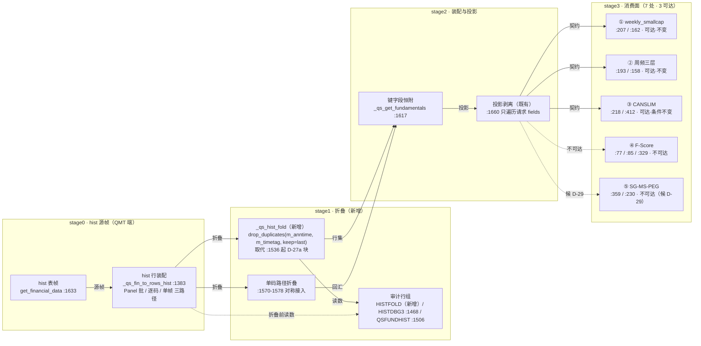

# D-28 影响面图（③实施轮）· 降级载体版

**生成时点**：2026-10-15 01:25（Asia/Shanghai）
**基线版本**：`0b88728`（D-30 R1-B 已提交；D-28 实施前树）
**图类型**：dataflow（折叠管线 → 消费面）
**载体**：mermaid 结构图（**降级**，原因见 §四）
**权威关系（写死）**：允许写入清单（`docs/qmt-hist-fold-design.md` v0.2.1 §三）才是机检闸；本图仅为其**可视化依据**，与清单不一致时**以清单为准并重画**。本图为**时点性审核对象、非活文档**；实施中若发生结构变更（新增挂载点/组件边界变化）属工单级变更，须重画重审。

---

## 一、结构图

## 二、节点 ↔ 证据源（可机检）

| 节点 | 证据源（文件:行） | 该行事实 |
| --- | --- | --- |
| hist 表帧 | `quantstudio/strategy_compiler/source_import_qmt.py:1633` | `C.get_financial_data(native_fields, codes, '19900101', …)` 取数调用 |
| 行装配 | 同上 `:1383` | `def _qs_fin_to_rows_hist(...)` 入口 |
| 折叠 helper | 同上 `:1536` / `:1528` | 被取代块起点（`try:` 起）/ 「D-27a 契约收敛」注释 |
| 单码路径 | 同上 `:1570-1578` | `if codes and hasattr(raw,'loc') …` 单帧分支 |
| 键字段恒附 | 同上 `:1617` | `native_fields = sorted(set([f"{native_table}.{fmap.get(f,f)}" …]))` |
| 投影剥离 | 同上 `:1660` | `for _lf in fields:` 只遍历请求字段 |
| 审计行组 | 同上 `:1468` / `:1506` | HISTDBG3 once 守卫 / QSFUNDHIST kept 口径注释 |
| ① weekly | `…/weekly_smallcap_growth_momentum_10_quantstudio.py:207` / `:162` | growth_ability 取数（含 publ_date）/ 取最新版 |
| ② 周频三层 | `…/周频小市值成长动量（三层止损）.py:193` / `:158` | 同源取数 / 取最新版 |
| ③ CANSLIM | `…/CANSLIM突破成长选股策略.py:218` / `:412` | eps 取数（含 publ_date）/ 严格 `>` 选题 |
| ④ F-Score | `…/F-Score选股RSRS择时.py:77` / `:85` / `:329` | 非 hist 三表 / `iloc[-1]` / profit_ability 请求 |
| ⑤ SG-MS-PEG | `…/SG-MS-PEG-HL防守型小市值成长交叉验证选股策略.py:359` / `:230` | roe 取数（缺 publ_date）/ `pairs.sort` 取近 5 期 |

## 三、影响面（六变化项 ＋ 六不变面）

**变化**：①hist 行集折叠（日频全史 → PIT 全报告期）②D-27a 自保护块被 `_qs_hist_fold` 取代 ③单码路径对称接入（二阶变化：`dropna(how='all')` 语义）④内部帧 +2 辅助列（m_anntime/m_timetag）⑤HISTFOLD 审计行新增 ⑥QSFUNDHIST `kept` 口径变折叠后。

**不变**：返回帧列集与顺序、函数签名、异常语义、PIT 与复权口径、请求→返回投影契约（调用方视角零变化）、非 hist 表路径（valuation / income / balance / cashflow 零接触）。

**P1-1 结构洞闭合链**：键恒附（`:1617`）→ 投影只遍历请求 `fields`（`:1660`）→ 辅助键不进返回帧。

## 四、降级记录（工具故障不得变成流程故障）

| 轮次 | 质量档 | 诊断总数 | 主要类别 | 处置 |
| --- | --- | --- | --- | --- |
| 1 | showcase | 1 | `repository-evidence/file-missing`（设计文档未入库） | 证据源改指 pinned revision 内源码 |
| 2 | showcase | 41 | 自撰路由与渲染器规划冲突 + 扇出穿越 | 撤除自撰 route/channelX/labelDx（29 键） |
| 3 | showcase | 31 | 走廊合并 / 微段 / 标签净空 | 结构修正：audit 移入 stage1、节点加宽、文案收紧 |
| 4 | standard | 18 | 边穿越节点 + 节点宽/文案超界 | 简化流标签（保留 4 条载荷标签） |
| 5 | standard | 8 | `schema/required`（label 为必填） | 短标签回填（2–5 字） |
| 6 | standard | 16 | 边穿越 + 净空 | 放宽 viewBox |
| 7 | standard | 13 | 边穿越 + 宽度/净空 | 判定不可收敛 |

**降级判据**：7 轮修复后**证据类诊断已清零**（`repository-evidence` 无报错），残余 13 条**全部为版式/走廊类项**（`clean-flow/edge-through-node`、`layout/constraint`），与 D-30 影响面图（2026-10-13）同因同形——**当前拓扑（4 段 × 12 节点 × 单独消费面五路扇出）超出 archify 3.0.1 版式闸的可收敛域**。
**降级动作**：改出本 mermaid 结构图承载同一拓扑与证据源（语义零损失；仅版面表达从 HTML 换成文本图形）。
**未过门禁的部分如实标注**：四门中 `validate` **FAIL**（版式项），`deliver`/`check`/`browser-check` **not-run**；HTML 产物 `index.html` **未生成**，故不交付 HTML。
**复现与退出条件**：候选与回执留在 `.archify/dataflow-qmt-hist-fold-20261015-0115/`（`candidate.dataflow.json` + `index.finalize.json`）；待 archify 升级 **3.1.0**（回执 `update.availableVersion`）后复跑同一命令即可验证是否已可收敛。

> **Update 提示（照实呈报）**：archify 已发布 3.1.0（installed 3.0.1，release notes: https://github.com/tt-a1i/archify/releases/tag/v3.1.0）。本机 Skill 未自动升级（不擅自升级）。

## 五、随 Plan 过审声明

本图作为 ③实施轮 Plan 第 ⑧ 项「验收判据＋回退条件」**子项**提交，**不新增独立确认节点**；未过审不得进入实施。图未替代任何机检判据——允许写入清单核对、包名/服务名体检、源码双侧核对、构建与自测门照旧执行。
