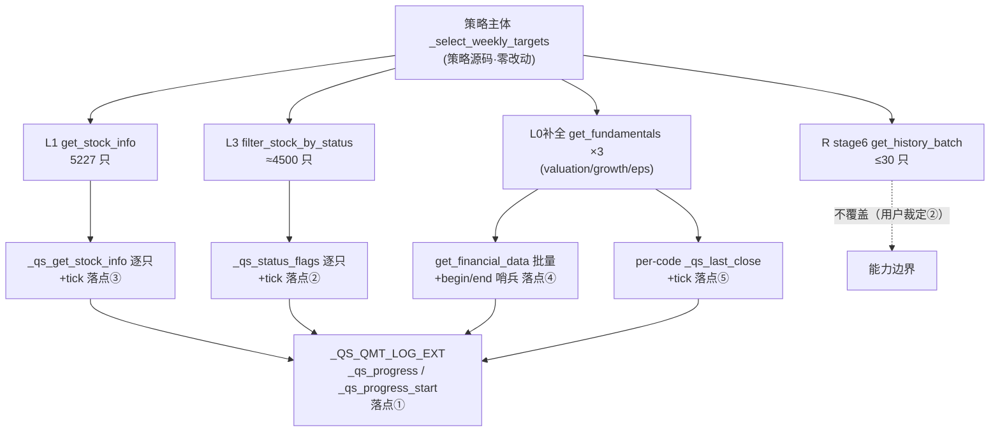

# D-24 验收证据：QMT 漏斗取数层进度审计行（2026-10-12）

> 判型：**新增检测型**（新增检测能力开始报告真相，非既有行为漂移）。
> 六步流水线：**③实施 + ④验收**（本文件）→ ⑤用户确认 / 并轮端测（D-23+D-24）→ ⑥随统出批。
> 设计依据：`docs/qmt-progress-audit-design.md` v1.2（②审计两轮闭环，sess_b7574342 → sess_fed0bb41）。

---

## 1. 改动面（＝允许写入清单核对）

```
 M docs/evidence/fundamentals-contract-matrix.md      ← 哈希同批追认（r2-P2-② 补入）
 M docs/evidence/fundamentals-contract-matrix.yaml    ← meta.qmt_wrapper_hash
 M quantstudio/strategy_compiler/source_import_qmt.py ← 实施本体
?? docs/qmt-progress-audit-design.md                  ← 设计方案（①环节产出）
?? tests/test_qmt_progress_audit.py                   ← 新增单测
```
**零越界**（除上列 5 项外无任何文件改动；策略源码与产物零触碰）。

diff 规模：`1 file changed, 108 insertions(+), 3 deletions(-)` —— 3 处删除＝3 个 `for` 头改 `enumerate` 等价形态（方案 §3.2 **A 类白名单**）。

### 五处落点（框架行号为实施前基准）

| # | 落点 | 内容 |
| --- | --- | --- |
| 1 | `_QS_QMT_LOG_EXT` | `_QS_QMT_PROGRESS_EVERY=500` + `_qs_progress_start()` + `_qs_progress()`（`time` 全部函数体内局部 import） |
| 2 | `_qs_filter_stock_by_status` 循环 | tick（重语句之后、分支之前） |
| 3 | `get_stock_info` 循环 | tick |
| 4 | `_qs_get_fundamentals` 批量调用 | begin/end 哨兵，**`finally` 配对 + `err=` 尾键** |
| 5 | `_qs_get_fundamentals` per-code 循环 | tick（r1 审计发现的覆盖缺口，**v1.1 新增**） |

### 实施中发现的缺陷与加固（局部豁免申报）

**契约边界缺陷**（自测暴露）：`_qs_progress(t0=0.0)` 时 `elapsed = time.time() - 0.0` → 输出
`elapsed=1791806094.2s`（epoch 秒数），**会严重误导"在算多久"判读**。
生产路径不受影响（`_qs_progress_start()` 恒返回真实正时间戳或 `None`），但属本目标文件内、
不改对外行为的加固 → 按**局部阻断修复分级豁免**直接修复：
```python
if t0 is not None and t0 > 0:      # 0/负数视为无效 → 记 0.0
    elapsed = _qs_t.time() - t0
```
并补边界用例 `test_h_t0_zero_treated_as_invalid`。

**契约描述瑕疵**（非代码缺陷）：行格式 `done=<n>/<total>` 为**复合字段**（total 作分母），
无独立 `total=` 键；方案 §4.1 **字段表**曾将其错列为独立字段（实现与 §4.5 示例本已一致）。
测试断言已按实际契约修正；方案 v1.2 §4.1 措辞同步澄清（纯文档，不改设计）。

---

## 2. 验收判据 a–i（逐项结果）

### 判据 a｜契约（tick 步长 / 静默 / 收尾 / 哨兵七字段 / begin-end 配对）
```
$ python -m pytest tests/test_qmt_progress_audit.py -q
15 passed in 0.67s
```
覆盖：步长命中打印 · 非步长不打印 · `total<500` 全静默 · `done==total` 收尾恒打印 ·
`end` 不受步长约束 · 哨兵行正则全字段匹配 · **异常路径 begin/end 仍成对且标 `err=1`**
（`get_financial_data` 抛异常 → `finally` 打印 end）。

### 判据 b｜黄金对照（零行为漂移）
以 `docs/evidence/_bak/source_import_qmt.py.bak-20261012-d24`（改动前副本，SHA256
`694C45D94EECEF729714C89051594A134C684006555C89D5710DB22712762CBF`）用 `SourceFileLoader`
加载为独立模块，同 mock ContextInfo 下逐位比对：
- `get_stock_info` 返回 dict **逐位一致**（含 `field` 白名单路径，2 组参数化）；
- `_qs_filter_stock_by_status` 返回 list **逐位一致**；
- `_qs_get_fundamentals` 返回 DataFrame `equals()` 为真，且 index/columns 一致；
- 未入映射表的早返回路径**零进度行输出**。
> 加载要点：须 `sys.modules[name] = mod`——该模块用 `@dataclass` + 字符串注解，
> `dataclasses._is_type` 依赖 `sys.modules` 查找。

### 判据 c｜既有回归零衰减
```
$ python -m pytest tests/test_source_import_qmt.py -q
49 passed in 1.42s      ← 与实施前基线一致（零衰减）
```

### 判据 d｜六策略横验证
```
$ python scripts/qmt_reconvert_six.py
CANSLIM突破成长选股策略 83268B sha16=3b5aea5f14f492ec enc=gbk portability=PASS selfcheck=PASS
fall_reversal        69778B sha16=51c9ba04c4297fc0 enc=gbk portability=PASS selfcheck=PASS
tech_etf_mvo         77579B sha16=ae46378119ef23fa enc=gbk portability=PASS selfcheck=PASS
vol_regime_mom_rev   85358B sha16=f662c9e1c3277a9b enc=gbk portability=PASS selfcheck=PASS
weekly_smallcap      79484B sha16=8c9becc2e71de18c enc=gbk portability=PASS selfcheck=PASS
周频三层              83866B sha16=928a574ff33cfd13 enc=gbk portability=PASS selfcheck=PASS
ALL 6 PASS (enc=gbk)                EXIT=0
```

### 判据 e｜产物增量可归因
| 策略 | D-23 后 | D-24 后 | Δ |
| --- | --- | --- | --- |
| CANSLIM突破成长选股策略 | 80299 | 83268 | **+2969** |
| fall_reversal | 66809 | 69778 | **+2969** |
| tech_etf_mvo | 74610 | 77579 | **+2969** |
| vol_regime_mom_rev | 82389 | 85358 | **+2969** |
| weekly_smallcap | 76515 | 79484 | **+2969** |
| 周频三层 | 80897 | 83866 | **+2969** |

Δ **恒定 2969B** = 同一段 helper + 四处调用点注入 → 无任何其他漂移。

### 判据 f｜哈希同批追认（yaml + md）
```
$ python scripts/check_fund_matrix.py --check --reverify
reverified: wrapper_hash -> 7a424f397983 | qmt_wrapper_hash -> 5c3586666747
OK: 契约矩阵门禁通过（哈希一致 + MD 一致）

$ python scripts/check_fund_matrix.py --check
OK: 契约矩阵门禁通过（哈希一致 + MD 一致）      EXIT=0
```

### 判据 i｜无 time 依赖泄漏（AST-only）
`test_i_no_module_level_time_import`（模块顶层无 `import time`）+
`test_i_time_import_only_local_in_log_ext`（模板内 `time` 仅出现于
`_qs_progress_start` / `_qs_progress` 函数体，其余模板零出现）——**均通过**。

### 判据 h｜elapsed 有效性
`test_h_elapsed_positive_when_t0_valid`（t0 有效 → `elapsed > 0`）+
`test_h_elapsed_falls_back_to_zero`（t0=None → 0.0）+
`test_h_t0_zero_treated_as_invalid`（t0=0.0 → 0.0）——**均通过**。

### 判据 g｜端测（候用户执行，与 D-23 并轮）
见 §5。

---

## 3. 影响面图

> ⚠️ **流程未完成项如实申报**：§10 要求由 `archify-gate` 产出正式影响面图。本会话已完成
> **环境预检**（Chrome 三处均不存在 → 按条款走 Edge，`C:\Program Files (x86)\Microsoft\Edge\
> Application\msedge.exe` 存在；archify skill 位于 `~\.agents\skills\archify`），但**未执行
> finalize/visual-check**——**原因是本会话上下文预算不足，非工具故障**（故不属条款内的降级情形）。
> 现以 mermaid 图作替代，**正式 archify 图候下轮补齐**，请用户裁定接受替代或要求补出。



**权威性**：允许写入清单仍为机检闸；图仅为该清单的可视化依据，冲突时以清单为准。
生成时点 2026-10-12；基线版本 commit `efaa698`（HEAD）。

---

## 4. 回退手段

| 层 | 手段 | 标识 |
| --- | --- | --- |
| ① stash 回退点 | `git reset --hard cc8c087` | `baseline-20261012-d24-progress`（19:48:33） |
| ② 文件级备份 | `Copy-Item` 覆盖 | `docs/evidence/_bak/source_import_qmt.py.bak-20261012-d24`（SHA256 `694C45D9…`） |
| ③ 哈希回退 | 二进制备份 + reverify | `docs/evidence/_bak/source_import_qmt.py.after-20261012-qmt-l1`（D-23 后版本） |

**四步配方附注**：`git add -A` 在本仓因 `agent_workspace/_wt_*` 嵌入仓库超时（>10min，两次实测），
改用 D-23 已实证路径——清理被 kill 进程残留的 `.git/index.lock` 后直接 `git stash create`
（tracked 改动全捕获；本轮新增文件另有文件级/文档内容保障）。属阻断性清理，特此附注。

---

## 5. 端测判据（D-23 + D-24 并轮，候用户执行）

GBK 产物经剪贴板粘入 QMT 编辑器保存后回测：

| 判据 | 期望 |
| --- | --- |
| **D-24 主判据** | 首日日志出现 `QS_QMT_PROGRESS` 行（`get_stock_info` / `filter_stock_by_status` / `get_financial_data begin-end` / `query_last_close`） |
| **D-24 配对判据** | 每次 `phase=begin` 必有同 `table` 的 `phase=end` |
| **D-23 主判据** | `QS_FUNNEL_AUDIT` 行 **`L1_listed > 0`**（与 `L0_all=5227` 同量级） |
| **推进判据** | `L6_eps > 0` → `R_selected > 0` → 产生交易 |
| **回归判据** | `get_history` 族（D-16a/D-17）与 `QSFUNDHIST`（D-19/D-22）不回退 |

---

## 6. 未闭合项

1. **判据 g 端测**（用户端，D-23+D-24 并轮）。
2. **正式 archify 影响面图**（§3，候下轮补齐）。
3. 方案 §4.1 措辞澄清（`done/total` 复合字段）已同步；不改设计实质。
