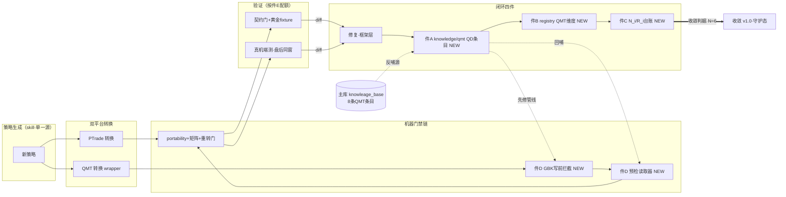

# D-33 · QMT 对齐闭环收口 统一方案（六步①，2026-10-16）

- **版本**：v1.2（①成稿＋三终裁落档＋**②审通过＋批 1 放行**；批 1 已完成候⑤呈批；两条件仅约束批 2；用户闸门＝⑤）
- **立项依据**：用户 2026-10-16 02:31 三裁定——**B·对等双库**／**本轮就补 registry QMT 维度列**／**P1-P4 一并立项**；08:51 Plan 照准＋三预裁（库位置＝主仓 `knowledge/qmt/`；R 口径＝GBK 例计 R_i>0 并先修管线；fix_layer 五枚举）。余三项（N 值／端测分级／QD 首批范围）随本方案呈终裁。
- **基线**：HEAD `722a545`（2026-10-16 08:52 实测）；registry.md 编辑基线 sha16 `98193e9fd36380ba`（干净，无他线叠加）。
- **执行节奏（用户令）**：方案获批后**先本地实现、统一随批推送双仓**（不单独推）。
- **迁移约束（用户令，写死）**：QuantStudio-trading 后期建独立远程仓且 QuantStudio 回测部分并入 trading ⇒ 件 A 库必须**迁移自包含**。

**知识反哺检索留痕**（2026-10-16 08:52，主库 `knowleage_base` 全域 grep＋repo `knowledge/` 通读）：
- 知识反哺：[命中] QMT大转换管线-部署通道与innerApi实测形态坑（06-数据与工具/QMT大转换管线-部署通道与innerApi实测形态坑.md，2026-10-16）——采纳：形态库优先纪律（「实测形态以探针库为准」）与 D-31 realtime 坑入 QCAL 锚；
- 知识反哺：[命中] 产物落盘编码契约-写盘点单点fail-closed加canonical重转门（07-经验库/产物落盘编码契约-写盘点单点fail-closed加canonical重转门.md，2026-10-16）——采纳：**「注释/文档字符串里的特殊字符是高频复发源」＝件 C R 口径（GBK 例计 R_i>0）的直接库证**；件 D 写前拦截预检为其回哺载体强化；
- 知识反哺：[命中] 平台转换坑-必填参数空串未定义行为返回静默空（07-经验库，2026-10-16）——采纳：QCAL-05（D-22）锚定依据；
- 知识反哺：[命中] 平台转换铁律-文档签名不可信须建运行实测形态库（07-经验库，2026-10-16）——采纳：QLC-02「已排查（形态库）」定级依据；
- 知识反哺：[命中] 端测纪律-QMT端测须盘后同窗同源黄金对照（11-方法论与工程体系，2026-10-16）——采纳：件 E 端测配额的时点纪律底座；
- 知识反哺：[命中] Archify出图门禁-五版迭代与schema约束（06-数据与工具，2026-10-16）——采纳：影响面图降级 mermaid 载体依据；
- 知识反哺：[命中] 平台文档库-platform-docs-索引（06-数据与工具，2026-10-16）——采纳：黄金三级制中「平台文档」级线索源（QMT 78 页）；
- 知识反哺：[命中] 验收盲点-skipna因子合成缺列不可区分须审计行直证（07-经验库，2026-10-16）——采纳：QD 条目 evidence 字段须含审计行指针的惯例。

---

## 一、问题定义（三断点＋一不对称，均有实证）

| # | 断点 | 实证 |
| --- | --- | --- |
| 1 | **收敛台账断档**：`docs/evidence/qmt-pipeline-convergence.md` 只回填到 batch2（10-11）＋M5.2 基建行；D-23~D-32 十余个 D 编号未回填 ⇒ 收敛曲线不可见 | 台账现存 3 行（batch1 N=11/R=0、batch2 N=11/R=0、M5.2「—」） |
| 2 | **回哺最后一公里未闭合**：PTrade 有 P0 预检「读 vault 已知坑→命中即注入」（ptrade-deploy-pipeline-design §8.4）；QMT 侧已知坑仍是文档/主库条目而非可机读入口 ⇒ 「洞在库里但没变成闸」 | 主库 8 条 QMT 相关条目 vs `portability_rules.py` 仅 7+ 类 rule_id；D-28 轮 GBK `≪`(U+226A) 复发即其后果（主库已有编码契约条目仍被踩，连带 17 例失败） |
| 3 | **端测人工瓶颈**：QMT 真机对照＝人工粘贴回抄（D-28 端测四轮实证），无配额规则 ⇒ 每改动全量端测不可持续 | D-28 端测成本 ≈25 分钟/轮（盘后窗约束） |
| 4 | **知识库结构不对称**：PTrade 有 trading 仓专属条目库（`vault/knowledge/ptrade-deploy/` PD-2026-0001..0006，frontmatter 机读）；QMT 无对应物（散在 `docs/qmt/` 形态库 18md＋主库条目＋N/R 台账） | 本方案起草前实测五处载体 |

## 二、目标与非目标

**目标**：QMT 侧达成与 PTrade 同构的「验证→修复→沉淀→回哺」常态闭环，且收敛可度量（N_i/R_i）、回哺可机读（预检读取器）、端测可配额——支撑 `qmt-conversion-design.md` 终局判据「新策略零修复通过率」走向可判定的收敛 v1.0。

**非目标**：不改引擎/转换器行为（本轮全部为知识库/台账/文档/预检脚本层）；不承诺「永无新洞」（平台演进注入新差集为棘轮式，诚实边界沿用 alignment-governance :95）；不迁移既有 PTrade 库。

## 三、改动范围（六件 A-F；允许写入清单按批次锁定，见 §八）

### 件 A · QMT 专属知识库 `knowledge/qmt/`（对等双库·B 方案，批 1）

- **位置（已裁）**：主仓 `knowledge/qmt/`——理由：QMT 转换/回测管线在主仓；共享层只修主仓铁律；trading 副本零本地改动铁律排除 trading 侧。
- **结构**：`README.md`（导览＋条目 schema 说明＋**迁移节**）＋条目文件 `QD-2026-xxxx.md`（一洞一件）。
- **条目 schema（1:1 对齐 PD，fix_layer QMT 适配〔已裁枚举〕）**：
  ```markdown
  ---
  id: QD-2026-0001
  symptom: "现象一句话（可检索）"
  root_cause: "根因一句话"
  fix_target: "修复落点：文件路径 + commit sha"
  fix_layer: wrapper | portability_rule | matrix | probe | ledger   # 强制框架层
  evidence: "验证证据指针（主仓路径）"
  fixture: "复现固件/测试路径"
  feedback:                              # 回哺方式（至少一项非空）
    contract_row: "registry/矩阵新增行描述或 null"
    gate_rule: "校验规则新增描述或 null"
    template_patch: "wrapper 模板改动描述或 null"
  status: open | closed
  closed_round: <n>
  ---
  正文：复现步骤 / 影响面 / 讨论（散文允许，frontmatter 必须完整）
  ```
- **首批回填范围（待终裁③）**：建议 D-12~D-32 已闭环坑**全量分批落**（批 1 先落 P1 级：D-21/D-22/D-28/D-30/D-31/D-32，余量批 2 补齐）；每件「指针不复制」（结论＋证据件指针，原文留 docs/evidence/）。
- **迁移自包含（硬约束）**：单目录；无跨库硬链（双链仅向下相对链接）；条目自包含（不依赖 `knowledge/` 上层文件即可读）；README 迁移节写明——「未来 QuantStudio 回测部分并入 QuantStudio-trading 时，本目录整体 mv 至 trading 仓 `vault/knowledge/qmt/`，与 `ptrade-deploy/` 同仓对等；迁移后仅需改 README 相对链」。
- **knowledge/README.md 导览表加入口**（随批 1 建库时一并——本轮暂不加，防死链）。

### 件 B · registry.md QMT 维度（本轮落地首块＋批 1 补全）

- **本轮（已批）**：
  1. 表头性质升级：双端对齐 → **三端**（本地 ↔ PTrade／本地 ↔ QMT）；
  2. POS/API/MCH/FEE/DAT 五节表格加 **「QMT 锚点」列**——**仅回填有证据者**（DAT-03 include 语义＝已锚定：wrapper `_qs_snap_kwargs` 锚定回测 bar 当日＋D-28 端测四轮 L0-L6 逐位一致；API-00＝已锚定（部分面）：portability 七类规则＋矩阵哈希＋49 用例），其余一律「未验证」（ IDX 为紧凑文本节，不加列，在 QMT 专属节注记）；
  3. 新增三个 **QMT 专属面节**（qmt-conversion-design :183 规划落地）：
     - **QLC**（生命周期专属）：QLC-01 handlebar 时机（未验证）／QLC-02 ContextInfo 语义（**已排查**：形态库 2043 行离线转写＋11 项实测定谳，`docs/qmt/inner-api/`）／QLC-03 生命周期壳改写（**已锚定**：portability `QMT-LIFECYCLE-SHAPE` 规则＋端测运行）／QLC-04 定时/遍历语义（未验证）；
     - **QMCH**（撮合/回测引擎专属）：QMCH-01 撮合价口径（未验证——match_profile qmt 档未建）／QMCH-02 涨跌停/停牌可成交性（未验证）／QMCH-03 T+1（未验证）／QMCH-04 费用/滑点配置面（未验证；文档线索：QS-qmt 回测参数面板 86-102）；
     - **QCAL**（日历/合约信息专属）：QCAL-01 合约信息活表漂移（**已锚定**：D-30 冻结快照层，15 用例；E2E 判据候窗标注）／QCAL-02 板块成份无 as-of（**已排查**：D-31 三档毫秒时间戳实测全静默空返回定谳）／QCAL-03 hist 日频全史帧→报告期折叠（**已锚定**：D-28 盘后正式归档判据 1/2/3 全过＋四轮交叉＋12 用例）／QCAL-04 profit_ability 映射缺失（**已知分歧**：D-29 候裁）／QCAL-05 endDate 空串静默空（**已锚定**：D-22 安全终点＋审计行）／QCAL-06 GBK 物理编码契约（**已锚定**：canonical 重转门四自检＋测试强制 `encode('gbk')`；**D-28 轮 `≪` 复发＝R 口径案例**，回哺强化见件 D）；
  4. 条目总览表加三行（QLC 4/QMCH 4/QCAL 6）＋变更记录追加。
- **批 1 补全**：knowledge/README.md 导览入口＋ID 脊柱互链注记（QD 条目 ↔ registry QCAL/QLC 行 ↔ 契约测试指针）。

### 件 C · P1 收敛台账回填（批 2，R 口径已裁）

- `docs/evidence/qmt-pipeline-convergence.md` 增 **batch3 行**（D-23~D-32 逐条）：N 明细＝D-23/D-24/D-26a-e/D-27a/D-27b/D-28/D-30/D-31/D-32；**R 明细＝D-28 轮 GBK `≪` 例计 R=1**（预裁已定；归因＝回哺链断裂——主库「产物落盘编码契约」条目在库而未机器拦截 → 先修管线＝件 D 写前拦截预检化）；D-32 计 N（D-30 引入的验收覆盖面缺口，非同坑复发）。
- 回填纪律：R_i 单元格文法按 `loop-ri-ni-plan.md` rev2（`<n>(<案型>|<归因>)`）；锚定案闭环行、非闭环行留「—」。

### 件 D · P2 回哺机器化（批 2）

- **预检读取器**（新脚本，落点 `scripts/qmt_kb_preflight.py`〔暂名，实施期定〕）：读 `knowledge/qmt/` 全部条目 frontmatter → 生成「已知坑清单」机读索引；转换预检阶段命中 symptom/关键词即 **WARN/BLOCK**（与 PTrade P0 §8.4 同构）。
- **写前拦截预检（GBK 强化，R=1 的先修管线动作）**：wrapper 模板/产物写入前 GBK 可编码性单点校验（`code.encode('gbk')` fail-closed，独立退出码）——把主库「编码契约」条目从「测试期暴露」前移到「写前拦截」。
- **高频坑→portability_rules 规则清单（批 2 评估，逐条六步）**：realtime 参数禁传（QCAL-02）、必填参数空串禁传（QCAL-05）、返回列=请求列结构假设禁用（D-28 P1-1 教训）。
- **BLOCK/WARN 判据边界先呈后落（②审条件②）**：批 2 实施前先出「判据边界表」呈审——哪些 symptom **必须 BLOCK**（如编码契约违规、必填参数空串、realtime 误传）、哪些仅 **WARN**（形态提示类、性能类坑），**防预检误杀正常转换**；边界表经审后固化为读取器配置。
- **钩子落点（②审条件①）**：GBK 写前拦截的**实效位置＝转换产物写入路径**（独立脚本不可独立达成）；落点文件已入 §八 批 2 允许写入清单；若钩子触及 wrapper 模板/渲染常量 ⇒ **矩阵哈希同 commit 追认**（`check_fund_matrix --check --reverify` 产物同 commit，既有铁律）。

### 件 E · P3 端测配额＋黄金 fixture 库（批 2/3，分级边界待终裁②）

- **配额分级（建议稿，待终裁）**：
  - **必端测**（真机）：新 API 面首用／新数据面接入（如 D-29 修① 后 profit_ability 首跑）／撮合口径变更（QMCH 系）；
  - **契约门替代**：wrapper 内部重构/性能型/纯文档——邻接套件＋六策略重转＋矩阵哈希＋黄金对件比对；
  - **黄金 fixture 库**：`docs/evidence/` 下 A/B 对件＋读数归档规则（D-28 四轮读数＝首批黄金基线，判据 3 比对可复用）；时点纪律＝盘后同窗（主库端测纪律条目）。

### 件 F · P4 呈裁件（随方案附呈，N 值待终裁①）

- **N 值建议＝6**：连续 **6 个新策略**首次转换即全门禁通过（双平台＋零框架层修复）⇒ 宣布对齐基线**收敛 v1.0**，转守护态（只处理平台漂移/新 API）。
- **统计口径建议**：样本＝canonical 六策略之外的新策略（skill 产出）；通过＝生成→双平台转换→（QMT 侧按件 E 配额）验证全绿，当轮零框架层 commit；
- **终点仪式**：registry 未验证数＋QMT 面未验证数公开、收敛曲线（N_i/R_i 台账）归档、宣布记录入 alignment-convergence.md。

## 四、影响面与判型

**判型：纯增益／新增检测型**（知识库＋台账＋预检脚本层；不改引擎/转换器/策略任何行为；registry 加列使 QMT 面开始报告真相＝新增能力，非行为漂移）。

**影响面图（Plan ⑧子项·mermaid 降级载体——沿 D-28 先例七轮版式闸不可收敛、archify 3.1.0 后复评）**：



（图与允许写入清单冲突时以清单为准；图为时点性审核对象，实施中结构变更须重画。生成时点 2026-10-16 09:0x｜基线 HEAD `722a545`。）

## 五、验收标准（分批）

- **本轮**：①本方案成稿（六要件＋反哺留痕＋六待裁项，可整件转发）；②registry.md QMT 维度落地——表格列数机检一致、`python scripts/check_dimension_alignment.py` 退出码改前后一致、`git diff` 逐 hunk 自检为我方内容；③簿记落账＋写前快照 hash 在案。
- **批 1**（件 A 建库＋首批 QD 条目＋件 B 补全）：`knowledge/qmt/` 结构齐（README＋≥6 条 P1 级条目，frontmatter schema 校验脚本过——机检：YAML 可解析＋必填字段齐＋feedback 至少一项非空）；README 导览入口生效；QD↔registry 互链抽检 3 条。
- **批 2**（件 C 回填＋件 D 读取器）：batch3 行回填（N/R 逐条＋文法机检过）；预检读取器对首批条目实跑命中≥1 例演示；GBK 写前拦截对 `≪` 样本实跑 BLOCK 演示；既有套件零衰减。
- **批 3**（件 E/F 随终裁落地）：配额规则入端测手册；N 值裁定记录归档。

## 六、风险与回退

| 风险 | 缓解 |
| --- | --- |
| registry/README 共享文件他线叠加 | 写前快照＋diff 逐 hunk 核对；他线 hunk 即停上报（本轮基线已核干净） |
| markdown 表格解析脆性 | 列数机检脚本＋`check_dimension_alignment.py` 退出码回归 |
| 六件范围大→一轮吞全量 | 分批硬约束（§八）；每批独立允许写入清单 |
| 迁移方案未来变化 | 件 A 迁移节容错（不写死绝对路径）；迁移演练留待合并立项时 |
| 台账回填 R 误判 | 仅已裁口径执行（GBK 例）；新疑义逐条呈裁 |

**回退**：本轮＝`git checkout -- knowledge/registry.md`（单文件定向）＋scoped stash 兜底按路径提取；批 1/2＝各批独立 git revert＋registry 行删除；方案文档为新增文件可直接删。

## 七、与迁移约束的关系（trading 合并预案）

- **现状**：PTrade 条目库在 trading 仓（`vault/knowledge/ptrade-deploy/`，因其管线在 trading）；QMT 库建主仓 `knowledge/qmt/`（其管线在主仓）——**两库各随其管线**，与「共享层只修主仓／增量层只存副本」铁律同构。
- **合并后（trading 独立远程＋QuantStudio 回测部分并入）**：`knowledge/qmt/` 整体迁至 trading `vault/knowledge/qmt/`，与 `ptrade-deploy/` 同仓对等——恰好收敛为「一仓双平台库」；主仓保留 N/R 台账＋指针（与 PTrade 侧 §8 修订②同款分工）。
- **迁移成本控制**：件 A 硬约束（自包含/相对链/迁移节）确保迁移＝一次目录 mv＋README 一行改。

## 八、分批实施计划（每批独立允许写入清单）

| 批 | 内容 | 允许写入清单（精确路径） | 前置 |
| --- | --- | --- | --- |
| 本轮 | 方案成稿＋registry QMT 列＋簿记 | `docs/qmt-alignment-loop-closure-design.md`（新）／`knowledge/registry.md`／`docs/ISSUES.md`／`docs/PROJECT_STATE.md` | ✅（Plan 已照准） |
| 批 1 | 件 A 建库＋首批 QD 条目＋件 B 补全（README 入口/互链注记） | `knowledge/qmt/**`（新）／`knowledge/README.md` | 总调度外审通过＋终裁③（首批范围） |
| 批 2 | 件 C 台账回填＋件 D 读取器＋GBK 写前拦截 | `docs/evidence/qmt-pipeline-convergence.md`／`scripts/qmt_kb_preflight.py`（新，名实施期定）／**`quantstudio/strategy_compiler/source_import_qmt.py`（GBK 写前拦截钩子落点——②审条件①：实效位置在转换产物写入路径，非独立脚本可独立达成；**若钩子触及 wrapper 模板/渲染常量 ⇒ `_QMT_HASH_SCOPE` 变更 ⇒ `scripts/check_fund_matrix.py --check --reverify` 产物（矩阵 yaml/md `qmt_wrapper_hash`）**同 commit 追认**〔既有铁律〕**）**／`quantstudio/strategy_compiler/portability_rules.py`（如落规则，独立六步）／`tests/**`（新） | 批 1 完成 |
| 批 3 | 件 E 配额手册＋件 F 归档 | `docs/evidence/d28-e2e-checklist-20261015.md` 或新手册件／`knowledge/alignment-convergence.md` | 终裁①② |

## 九、附呈终裁三项（预裁已定三项之外的余项）

1. **N 值**（件 F）：建议 **6**；备选 4（更快宣布、样本薄）／8（更稳、周期长）。
2. **端测配额分级边界**（件 E）：建议稿见 §三件 E——「必端测＝新 API 面首用/新数据面接入/撮合口径变更；其余契约门替代」是否照准或收紧/放宽。
3. **QD 首批回填范围**（件 A）：建议 **P1 级 6 件先行**（D-21/D-22/D-28/D-30/D-31/D-32）＋批 2 补齐 D-12~D-20/D-23/D-24/D-26/D-27/D-29；备选＝一次全量落。

## 十、裁定记录（用户 2026-10-16 09:35）

**三终裁（§九 三项已裁定，全部采信建议稿）**：

| # | 事项 | 裁定 | 落位 |
| --- | --- | --- | --- |
| ① | N 值 | **N=6 采信**（与「6 策略横验证」口径先例一致；4/8 不取） | 件 F（§三件F／§五批 3） |
| ② | 端测配额分级 | **照准**——必端测三边界＝**新 API 面首用／新数据面接入／撮合口径变更**；行为不变类＝**契约门＋黄金 fixture**（D-28 四轮读数为首批黄金） | 件 E（§三件E／§五批 3） |
| ③ | QD 首批范围 | **P1 级 6 件先行照准**（D-21/D-22/D-28/D-30/D-31/D-32）；批 2 补齐 D-12~D-20/D-23/D-24/D-26/D-27/D-29 | 件 A（§三件A／§五批 1） |

**流程裁定**：本方案 **②审＝总调度亲读方案全文出裁定**（下一轮）；**批 1 开工以②审通过为前置**；**用户闸门＝⑤**（批 1 实施后呈批）；本地实现**随批双推**维持（不单独推）。

**预裁三项（2026-10-16 08:51，已在卷）**：库位置＝主仓 `knowledge/qmt/`；R 口径＝GBK 例计 R_i>0 并先修管线（写前拦截预检化）；fix_layer 枚举＝`wrapper|portability_rule|matrix|probe|ledger`。

**②审结论（2026-10-16 10:33，总调度亲读全文对表）**：**通过**——问题定义四断点全实证／知识反哺 8 命中 grep-able＋采纳点／六件结构与判型（纯增益＋新增检测型）正确／分批允许写入清单＋前置齐／迁移自包含硬约束／风险回退具体／裁定记录完备／mermaid 降级披露合规。
**附两条件（只约束批 2，不阻批 1）**：①批 2 允许写入清单补「GBK 写前拦截钩子落点文件」＋若触及 wrapper 模板/渲染常量则矩阵哈希同批追认显式入计划（本版已落 §八 批 2 行与件 D）；②件 D 预检 BLOCK/WARN 判据边界**先呈后落**（防预检误杀正常转换）。
**导读卡三自陈风险照准**：件 D 脚本暂名可接受／QD 条目**各成条目＋互链**（D-30 与 D-32 分立）／件 F 终点仪式**沿用 S4 台账格式**。
**批 1 放行（2026-10-16 10:33）**：件 A 建库＋P1 级 6 条 QD＋件 B 补全；**批 1 完成后呈批走 ⑤ 用户闸门**。

## 变更日志

| 日期 | 版本 | 内容 |
| --- | --- | --- |
| 2026-10-16 | v1.0 | ①成稿：六件 A-F＋三预裁落档＋三终裁附呈＋分批计划＋影响面 mermaid（降级载体披露） |
| 2026-10-16 | v1.1 | **三终裁落档**（N=6／端测配额分级照准／QD 首批 P1 级 6 件先行）＋**②审口径**（**总调度**亲读方案全文出裁定，批 1 前置；用户闸门＝⑤）＋新增 §十 裁定记录 |
| 2026-10-16 | v1.2 | **②审通过＋批 1 放行**；两条件折入（①批 2 清单补钩子落点文件＋矩阵哈希同批追认；②件 D BLOCK/WARN 边界先呈后落）；导读卡三自陈风险照准；批 1 完成后呈批走⑤ |
