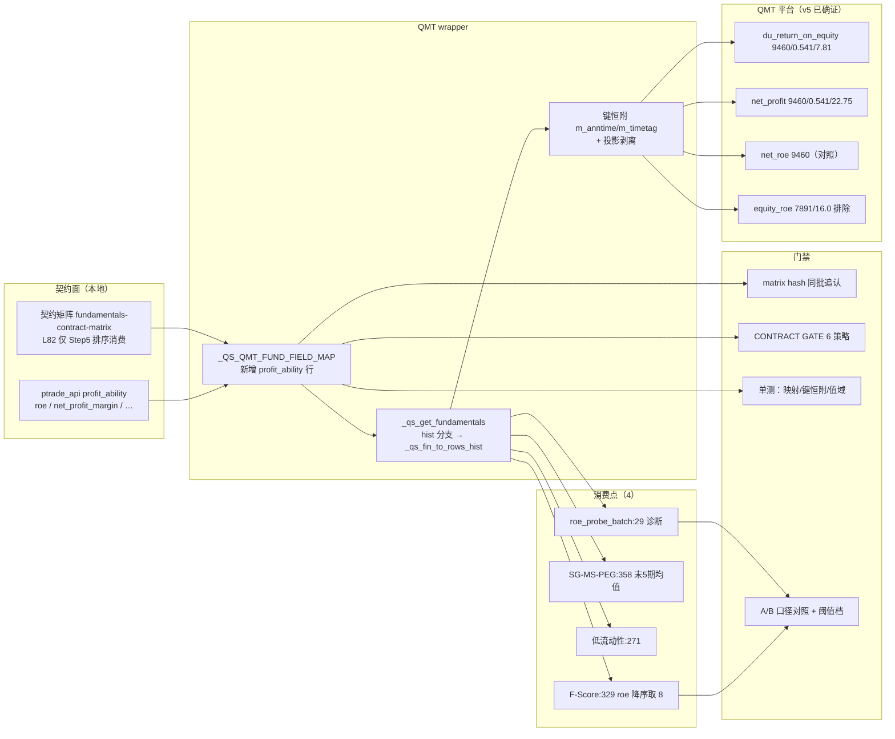

# D-29 · QMT `profit_ability` 原生比率字段映射（六步①方案，v1.0）

- **版本**：v1.0（六步①成稿，候总调度②审）
- **立项依据**：用户 2026-10-17 01:0x 三裁——①`roe` → **`du_return_on_equity`**（①A 照准，**①C `equity_roe` 明确排除**）；②顺带 **`net_profit_margin` → `net_profit`**（作为**独立映射行**登记、各自验收，防一轮吞全量）；③口径**三件套**（口径未确证＋消费面排序为主＋实施后 A/B 对照一次定口径）＋**阈值消费面额外对照档**。
- **基线**：HEAD `4764a0e`（D-33 推送后）｜`qmt_wrapper_hash` = `20f58868117f`（矩阵 yaml `meta`）。
- **判型**：**数据修正型**（QMT 端 hist 表行集回归本地契约口径；diff 只能归因于补映射后的非空帧；准确度只升不降）。

**知识反哺检索留痕**（2026-10-17 01:0x，主库 `knowleage_base` 全域 grep ＋ repo `knowledge/`）：
- 知识反哺：[命中] 审计方法论-先证可达性再证敏感性与无先例断言定谳（11-方法论与工程体系/审计方法论-先证可达性再证敏感性与无先例断言定谳.md，2026-10-17）——采纳：**D-28-a 可达性漏检**即本缺陷登记时的原始误报（`profit_ability` 未入映射表 → 恒空帧 → hist 分支死代码），本方案以「映射补全 + 消费点可达性实测」双证闭合；
- 知识反哺：[命中] ROE因子（02-因子与指标/因子/ROE因子.md，2026-10-17）——采纳：**`ROE = 净利润/净资产`、方向正向、熊市/震荡市防御核心、可用 TTM 替代、ROE 可被杠杆扭曲（建议结合 ROA/杜邦）**；据此 `du_return_on_equity`（净资产收益率）作为口径最近的候选成立，且 `total_roe`（ROA）本轮**不纳入**（避免一轮吞全量）；
- 知识反哺：[命中] 行情因子适配速查表（03-市场状态，2026-10-17）＋量化策略完整工作流（01-策略，2026-10-17）——采纳：**ROE 在多个消费面均为「排序/阈值」用法**（熊市防守权重 15%~20%、震荡市质量底线 ROE>6%/>8%），与契约矩阵 L82「仅 Step5 排序消费」互证 ⇒ 排序面对单位不敏感，但**非零阈值面对单位敏感**（故设阈值档）；
- 知识反哺：[无命中] 主库无「QMT PERSHAREINDEX 比率类字段命名族（无 `s_fa_` 前缀）」条目 ⇒ **本轮形态知识为新增**，须回灌（回哺载体：`docs/probe/qmt_profit_ability_probe_v5-20261017.py` ＋ QD 条目 ＋ 主库形态条目）。

---

## 一、问题定义（实证）

| 项 | 事实 |
| --- | --- |
| **契约分叉** | 本地 `ptrade_api` **支持** `profit_ability` 表（`ptrade_api.py:899` 字段：`roe`/`roa`/`roic`/`net_profit_margin`/`gross_profit_margin`/`operating_profit_margin`/`total_profit_net_profit`/`expense_to_revenue`/`operate_profit_to_profit`/`net_profit_to_balance`/`roe_avg`/`roa_avg`）；QMT wrapper `_QS_QMT_FUND_FIELD_MAP` **无 `profit_ability` 行** |
| **后果** | `_qs_get_fundamentals` 对未映射表**早退返回全 NaN 空帧**（不抛错）⇒ 消费点在 QMT 端**静默退化** |
| **自相矛盾** | hist 分支表集含 `profit_ability`（`:1736`）⇒ 该分支对此表是**死代码** |
| **消费点** | `F-Score选股RSRS择时.py:329`（`fields=['roe']`，降序取 8）／`SG-MS-PEG:358`（`roe` 末 5 报告期均值）／`低流动性:271`／`roe_probe_batch:29`（诊断） |
| **平台侧已确证** | v5 探针（2026-10-17 00:21 端测，生产口径）**4 命中**：`du_return_on_equity` valid=9460/ratio=0.541/sample=7.81；`net_roe` 9460/0.541/7.53；`equity_roe` 7891/0.451/**16.0（整数异常）**；`net_profit` 9460/0.541/22.75。**未命中**：`total_roe`/`gross_profit`（本轮不纳入） |
| **文档依据** | Context7 `/websites/dict_thinktrader_net`（`nativeApi/xtdata.html`）：`PERSHAREINDEX` 比率类字段**无 `s_fa_` 前缀**（`du_return_on_equity`/`equity_roe`/`net_roe`/`total_roe`/`gross_profit`/`net_profit`）；`ASHAREINCOME`/`ASHAREBALANCESHEET` 合成字段亦已文档化（本轮不启用） |
| **口径状态** | 本地 `profit_ability.roe` **口径定义本地不存在**（用户亲核：`ptrade_api.py:899` 仅字段清单）；契约矩阵 **L82** 固化注记：**「date 模式非 PIT（无 ann_date）；仅 Step5 排序消费（RD-2 固化断言）；roe 列表批量 probe:P5」** |

## 二、改动范围（允许写入清单）

| # | 文件 | 改动 | 类型 |
| --- | --- | --- | --- |
| 1 | `quantstudio/strategy_compiler/source_import_qmt.py` | `_QS_QMT_FUND_FIELD_MAP` 增 **两行独立映射**： ①`'profit_ability': ('PERSHAREINDEX', {'roe': 'du_return_on_equity', 'net_profit_margin': 'net_profit', 'publ_date': 'm_anntime', 'end_date': 'm_timetag'})` ②（登记表见 §二·2）第二行为**独立映射行**（`net_profit_margin` 单独登记在矩阵 `qmt.*` section） | 框架层（wrapper 模板常量） |
| 2 | `docs/evidence/fundamentals-contract-matrix.yaml` + `.md` | `qmt.*` section 增 `profit_ability` 契约行（`table`/`fields`/`tested`/`probed`/`probe_ref`/`rd`/`notes`），**两映射行各自登记、各自验收** | 契约矩阵 |
| 3 | `tests/test_qmt_fund_field_map.py`（新建） | 映射存在性＋键恒附＋投影零变化＋值域合理性（ROE 百分比量级）单测 | 测试 |
| 4 | `docs/probe/`（已在卷 v1–v5） | 探针件保留为**仪器迭代证据链**（三次拒判＋两次结论更正），**不删不改** | 证据 |
| 5 | `knowledge/qmt/QD-2026-0007.md`（新建） | QD 条目（回哺闭环：`fix_layer: wrapper`；`feedback.contract_row` 指矩阵新行；`gate_rule` 记「未映射表须早退告警」候选） | 知识库 |

**不在范围内（防一轮吞全量）**：`roa`/`roic`/`gross_profit_margin`/`operating_profit_margin`/`total_profit_net_profit`/`expense_to_revenue`/`operate_profit_to_profit`/`net_profit_to_balance`/`roe_avg`/`roa_avg` 等**其余十项字段本轮不映射**（待本轮验收通过后按需增量）；`total_roe`/`gross_profit` **v5 已证无效**（探针 0 命中），不纳入。

## 三、口径三件套（用户③裁定，逐条落法）

1. **口径未确证**：本地 `profit_ability.roe` 口径定义本地不存在（用户亲核）⇒ 方案显式标注「口径未确证」，**不得在代码注释或契约表中写入未经证实的口径断言**（如「加权/摊薄/百分比」只标注 QMT 侧原生字段名与其文档中文名）。
2. **消费面排序为主**：以契约矩阵 **L82** 为准（`notes` 原文引用）⇒ 排序面对单位不敏感；**非零阈值面对单位敏感**（主库多处 ROE>6%/>8% 阈值用法为佐证）。
3. **实施后 A/B 对照一次定口径**：验收阶段以 A/B 对件（本地 vs QMT 产物，同区间同参数）读 `roe`/`net_profit_margin` 数值——
   - **倍数恒定 ⇒ 单位差**（教训：倍数恒定几乎必是单位差）⇒ 立诊立修（映射侧乘/除系数，或改选同量级字段）；
   - **量级一致但数值不等 ⇒ 口径差（加权/摊薄/TTM/期末）** ⇒ 按主库 ROE 因子条目「净利润/净资产」定义对齐，择一映射并在契约表固化；
   - **完全无值 ⇒ 映射失效** ⇒ 回退本轮改动（§六）。

**附加档 · 阈值消费面对照**：若 `F-Score` 类阈值消费面（`F-Score选股RSRS择时.py:327`，若其 `roe` 阈值**非 0**）存在，则单位不钝感 ⇒ 验收加一档「阈值穿越一致性」对照（本地与 QMT 两侧在同一阈值下选出/剔除的标的集合是否逐位一致）；阈值为 0 或仅排序时该档记「不适用（单位不敏感）」并说明理由。

## 四、实施要点（③实施轮执行清单）

1. 写前快照（scoped 四步配方）＋ 精确 add（**禁止 `git add -A`**）。
2. 改 `_QS_QMT_FUND_FIELD_MAP`（**两映射行**）——**触 `_QMT_HASH_SCOPE`（`_QS_QMT_FUND_FIELD_MAP` 在 20 常量清单内）⇒ 矩阵哈希 `--check --reverify` 产物（yaml `meta.qmt_wrapper_hash` ＋ md）**同 commit 追认**（既有铁律，②审条件①同款纪律）。
3. 单测（新建）：映射存在性／键恒附（`publ_date`/`end_date` 自动附加后投影剥离⇒返回列零变化）／值域合理性／未映射表早退语义不变。
4. 复跑：`check_fund_matrix.py --check`（追认后 OK）＋ `run_contract_gate.py --strategies`（CONTRACT GATE 含 6 策略 api_portability）＋ QMT 相关七套件（回归零衰减）。

## 五、验收标准（④验收轮）

| # | 判据 | 通过条件 |
| --- | --- | --- |
| 1 | **矩阵哈希同批追认** | `check_fund_matrix.py --check --reverify` 产出新 `qmt_wrapper_hash`；同 commit 含 yaml＋md；`--check` 过后 OK；负向门 5/5 |
| 2 | **六策略零回归** | `run_contract_gate.py --strategies` CONTRACT GATE PASS；QMT 相关套件全绿且**零新增失败** |
| 3 | **映射生效（消费点可达性）** | QMT 端 `roe_probe_batch`（既有诊断策略）读 `QS_QMT_HISTDBG3 t=profit_ability` **`rows>0`**、`QSFUNDHIST t=profit_ability kept>0`（**非空帧**＝映射生效；对照＝改前恒 0） |
| 4 | **口径 A/B 对照** | 按 §三 3 三分支给出结论（倍数恒定／口径差／无值）并落证据 |
| 5 | **阈值档** | 按 §三 附加档执行或记「不适用＋理由」 |
| 6 | **契约矩阵登记** | `qmt.*` section 两映射行齐备（字段／probe_ref／notes 引 L82） |
| 7 | **纯增益** | 既有 eps/growth_ability/valuation 三映射**零变化**（diff 仅新增 `profit_ability` 行）；既有测试与黄金结果零衰减 |

## 六、回退条件

- 判据 3 或 7 失败 ⇒ **回退本轮全部改动**（`git revert` 单 commit ＋ 矩阵哈希随 revert 回退；`check_fund_matrix --check` 复跑确认）；
- 判据 4 判「无值」⇒ 同上回退，并在 ISSUES 登记「映射候选被否证」，转入裁②（移除表集＋告警）或合成路径（独立立项）；
- 判据 4 判「单位差/口径差」且本轮不可一次定案 ⇒ **不扩大范围**，登记 ISSUE 并呈裁（改选同量级字段 or 加系数），**禁止在实施轮临时扩字段**；
- 写前快照 hash 记入会话记录（`git stash show --stat` 核对内容，按路径单文件提取）。

## 七、影响面（mermaid，Plan ⑧子项 · 降级载体披露）

> 依 D-28 先例（本拓扑 archify 3.0.1 版式闸七轮不可收敛），本轮以内嵌 mermaid 作影响面载体；**图与允许写入清单冲突时以清单为准**。生成时点 2026-10-17 01:1x｜基线 HEAD `4764a0e`。

## 八、风险与卡点

| 风险 | 缓解 |
| --- | --- |
| 口径未确证 ⇒ 数值差被误判为回归 | §三 三分支判据先定；「倍数恒定⇒单位差」立诊立修；不可定案则不扩范围、呈裁 |
| 阈值消费面对单位敏感 | 阈值档对照（§三 附加档）；阈值为 0/仅排序时记不适用＋理由 |
| `_QMT_HASH_SCOPE` 变更 ⇒ CI contract-gate FAIL | 矩阵哈希**同 commit** 追认（铁律纪律②审条件①） |
| `profit_ability` 表集本就在 hist 分支（死代码）⇒ 映射后行为从「恒空」变「有值」 | **数据修正型**声明；diff 只能归因于非空帧；eps/growth_ability 三映射零变化（判据 7） |
| 与他线工作区叠加 | 精确 add＋暂存面核对（教训 44）；`source_import_qmt.py` 属共享核心文件，提交前 diff 自检 |

## 九、变更日志

| 日期 | 版本 | 内容 |
| --- | --- | --- |
| 2026-10-17 | v1.0 | ①成稿：三裁落档（①A `du_return_on_equity`／独立 `net_profit` 行／口径三件套＋阈值档）＋v5 探针 4 命中实证＋知识反哺留痕 4 条（含 1 条无命中）＋影响面 mermaid（降级载体披露）＋验收七判据＋回退四分支 |
